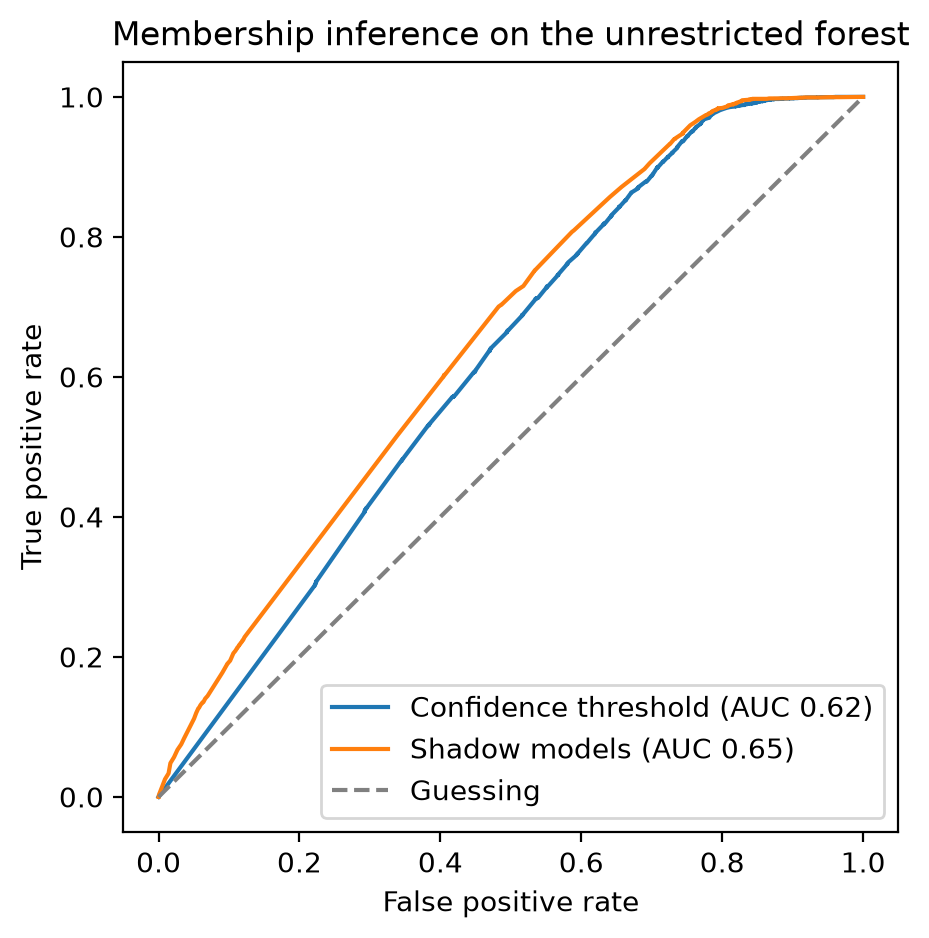
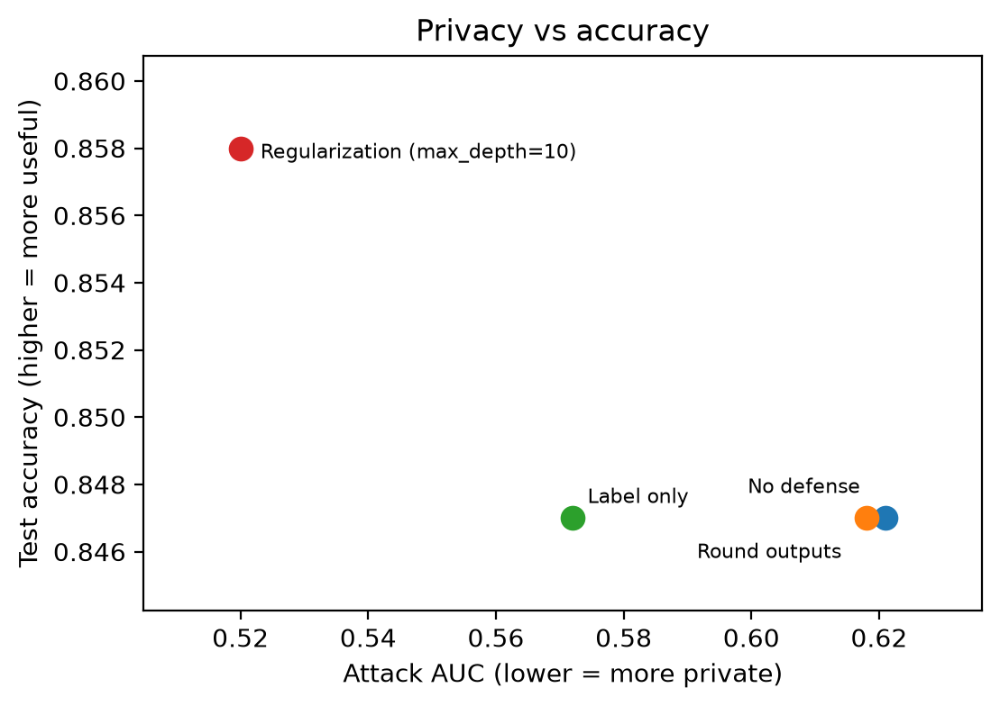

# Memorization and Privacy in Machine Learning: Membership Inference Attacks and Defenses

Can an attacker tell whether a person's record was used to train a model? This project trains income prediction models on the Adult Census dataset, attacks them with two membership inference attacks, measures how memorization affects privacy leakage, and tests three defenses.

**Author:** Aakash Tiwari, M.S. Cybersecurity, Rowan University

## Data

Adult Census Income from the UCI Machine Learning Repository (Becker & Kohavi, 1996): 32,561 records, 30,162 after removing rows with missing values. The task is predicting whether income is above $50K. The notebook loads the data directly from a public copy on GitHub.

| Part | Size | Role |
|------|------|------|
| Members | 5,000 | Used to train the target model |
| Non-members | 5,000 | Never seen by the target model |
| Shadow pool | 15,081 | Data the attacker owns |

## Attacks

- **Confidence threshold:** uses the probability the model gives to the true label. Members tend to get higher confidence.
- **Shadow models:** the attacker trains 4 random forests on their own data, then trains an attack model (gradient boosting) on their outputs to learn what membership looks like (Shokri et al., 2017). The attacker is assumed to know the target model type.

Attack success is measured with AUC (0.5 = guessing) and the true positive rate at a 1% false positive rate (TPR at 1% FPR).

## Results

### Memorization and leakage (random forest, confidence attack)

| max_depth | Train acc | Test acc | Gap | Attack AUC |
|-----------|-----------|----------|-----|------------|
| 2 | 0.763 | 0.765 | -0.002 | 0.500 |
| 6 | 0.849 | 0.841 | 0.008 | 0.506 |
| 10 | 0.874 | 0.858 | 0.017 | 0.520 |
| 15 | 0.918 | 0.861 | 0.058 | 0.553 |
| 20 | 0.966 | 0.858 | 0.107 | 0.581 |
| None | 0.992 | 0.847 | 0.145 | 0.621 |


Leakage grows with the gap between train and test accuracy. The deeper the trees, the more the model memorizes its training data.

### Attacks on the unrestricted forest

| Attack | AUC | TPR at 1% FPR |
|--------|-----|---------------|
| Confidence threshold | 0.621 | 0.000 |
| Shadow models | 0.654 | 0.025 |



The shadow model attack is stronger. The confidence attack gets 0 at 1% FPR because many members and non-members both receive a confidence of exactly 1.0, so the attacker cannot separate them at that strict threshold.

### Defenses

| Defense | Test acc | Attack AUC |
|---------|----------|------------|
| No defense | 0.847 | 0.621 |
| Round outputs to 1 decimal | 0.847 | 0.618 |
| Label only | 0.847 | 0.572 |
| Regularization (max_depth=10) | 0.858 | 0.520 |



- Rounding the output barely helped.
- Returning only the label reduced leakage but did not remove it.
- Regularization reduced leakage the most and also improved test accuracy, because the unrestricted model was overfitting.

### Who is most at risk

| Group | Records | Attack AUC |
|-------|---------|------------|
| Common profile | 9,270 | 0.619 |
| Rare profile (native country and occupation shared by fewer than 20 people) | 730 | 0.640 |

Records with rare profiles had a slightly higher attack AUC. The gap is small and comes from a single split, so it should be confirmed with repeated runs.

## Limitations

- All results come from a single random split. Repeating with several seeds would give error bars.
- Only random forests on one tabular dataset were tested.
- The attacker is assumed to know the target model type.

## Future work

- Add a differential privacy defense (DP-SGD with a neural network) and compare its privacy-accuracy trade-off with regularization
- Implement a stronger attack such as LiRA (Carlini et al., 2022)
- Repeat the experiments with neural networks and image data

## Project structure

```
memorization_and_privacy.ipynb   notebook with all experiments
figures/                         charts saved by the notebook
requirements.txt
```

## Run

```
pip install -r requirements.txt
jupyter notebook memorization_and_privacy.ipynb
```

## References

- Shokri, Stronati, Song, Shmatikov. Membership Inference Attacks against Machine Learning Models. IEEE S&P 2017
- Carlini, Chien, Nasr, Song, Terzis, Tramer. Membership Inference Attacks From First Principles. IEEE S&P 2022
- Becker, Kohavi. Adult. UCI Machine Learning Repository, 1996
