# Membership Inference Attacks: Measuring Training Data Leakage and Defenses

Can someone tell whether a person's record was used to train a model? This project trains income prediction models on the Adult Census dataset, attacks them with two membership inference attacks, studies what makes leakage worse, and tests three defenses.
[](https://doi.org/10.5281/zenodo.24187133)

**Author:** Aakash Tiwari, M.S. Cybersecurity, Rowan University

## Main results

| Result | Value |
|--------|-------|
| Attack AUC, depth 2 vs unrestricted forest (mean of 5 splits) | 0.503 → 0.627 |
| Correlation between train-test gap and attack AUC | 0.994 |
| Confidence attack: AUC / TPR at 1% FPR | 0.621 / 0.000 |
| Shadow model attack: AUC / TPR at 1% FPR | 0.654 / 0.025 |
| Best defense (max_depth=10): attack AUC / test accuracy | 0.520 / 0.858 |

AUC of 0.5 means the attacker is guessing. TPR at 1% FPR is the share of members caught while wrongly flagging only 1% of non-members.

## Data

Adult Census Income from the UCI Machine Learning Repository (Becker & Kohavi, 1996). 30,162 records after removing missing values. The task is predicting whether income is above $50K. The notebook downloads the data by itself.

| Group | Records | Role |
|-------|---------|------|
| Members | 5,000 | Training data for the target model |
| Non-members | 5,000 | Never seen by the target model |
| Shadow pool | 15,081 | Data the attacker owns |

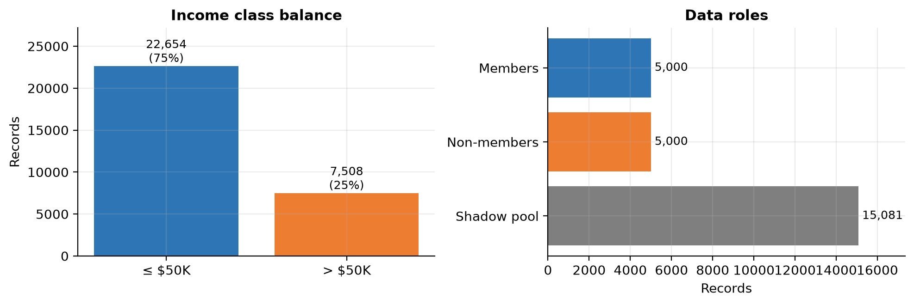

## Attacks

- **Confidence attack:** uses how confident the model is about the true label. Members tend to get higher confidence.
- **Shadow model attack:** the attacker trains shadow random forests on their own data, then a gradient boosting model that learns what membership looks like (Shokri et al., 2017).

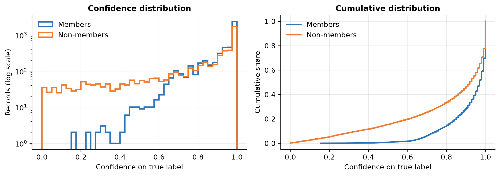

The model is much more confident on its training records. That gap is what the attacks use.

## Results

### Deeper trees leak more

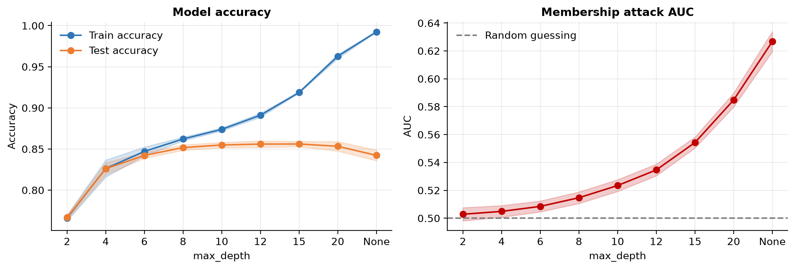

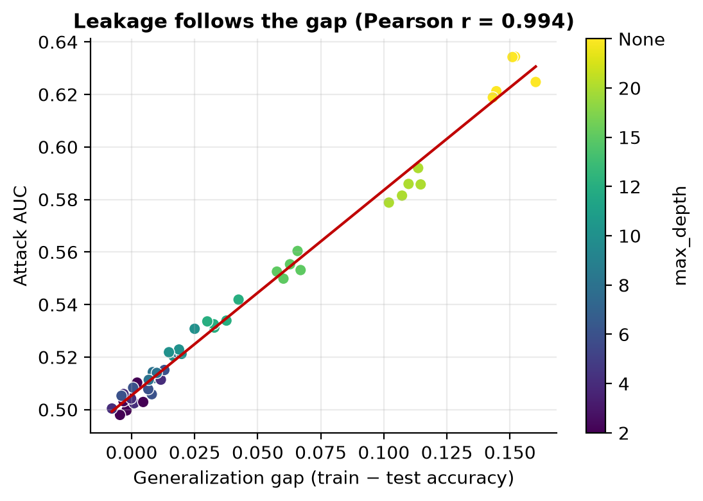

Repeated over 5 random splits. Leakage grows with the gap between train and test accuracy (r = 0.994).

### Shadow models are the stronger attack

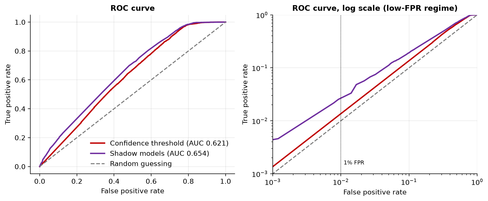

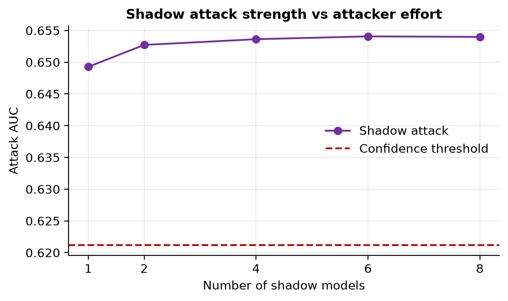

The shadow attack wins, especially at low false positive rates. One or two shadow models are already enough.

### Smaller training sets leak more

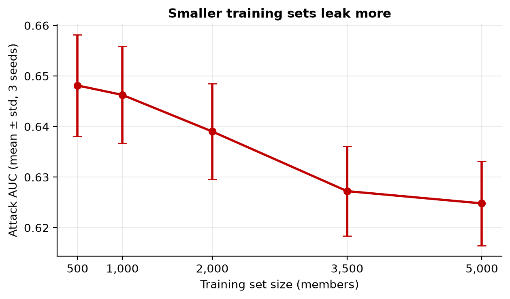

### Defenses

| Defense | Test accuracy | Attack AUC |
|---------|---------------|------------|
| No defense | 0.847 | 0.621 |
| Round outputs to 1 decimal | 0.847 | 0.618 |
| Label only | 0.847 | 0.572 |
| Regularization (max_depth=10) | 0.858 | 0.520 |

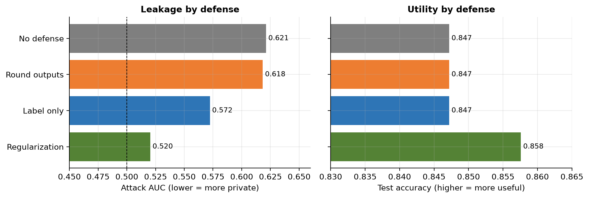

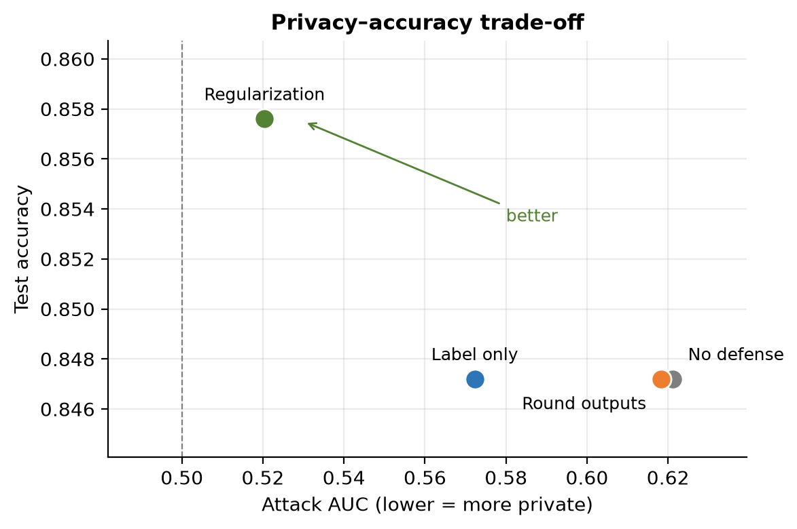

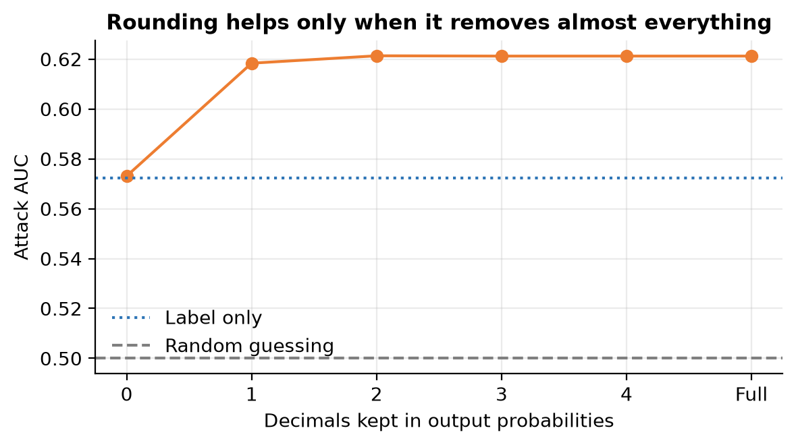

Regularization reduced leakage the most and also improved accuracy, because the unrestricted model was overfitting. Rounding barely helped. Label only helped but did not remove leakage.

### Who is most at risk

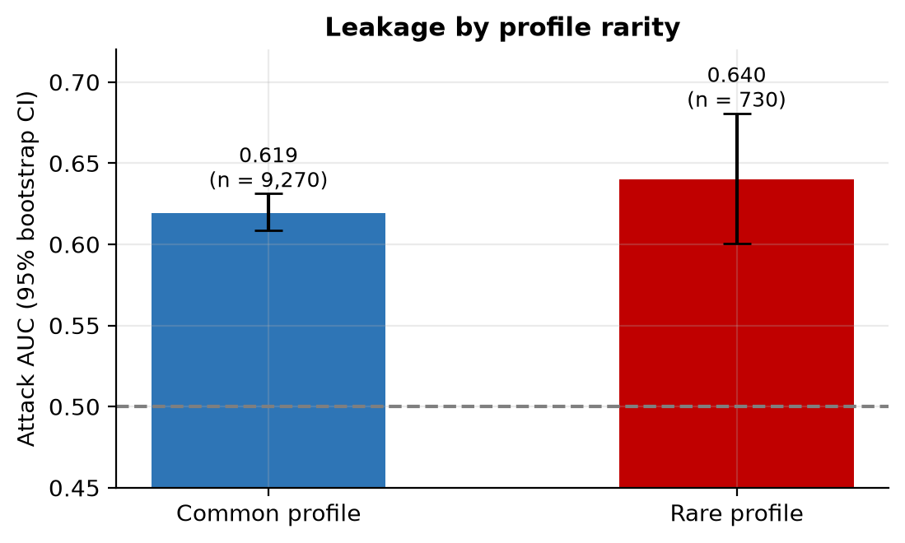

Records with rare profiles (native country and occupation shared by fewer than 20 people) had a slightly higher attack AUC (0.640 vs 0.619), but the 95% intervals overlap.

## Limitations

- Only random forests on one tabular dataset were tested.
- The shadow attack assumes the attacker knows the model type.
- Defenses were tested against the confidence attack only.

## Future work

- Differential privacy (DP-SGD) compared with regularization
- A stronger attack such as LiRA (Carlini et al., 2022)
- Neural networks and image data

## Project structure

```
membership_inference_attacks.ipynb             all experiments
figures/                                       11 figures saved by the notebook
Membership_Inference_Attacks_Documentation.docx   full project write-up
requirements.txt
```

## Run

```
pip install -r requirements.txt
jupyter notebook membership_inference_attacks.ipynb
```

## References

- Shokri, Stronati, Song, Shmatikov. Membership Inference Attacks against Machine Learning Models. IEEE S&P 2017
- Carlini, Chien, Nasr, Song, Terzis, Tramer. Membership Inference Attacks From First Principles. IEEE S&P 2022
- Becker, Kohavi. Adult. UCI Machine Learning Repository, 1996
